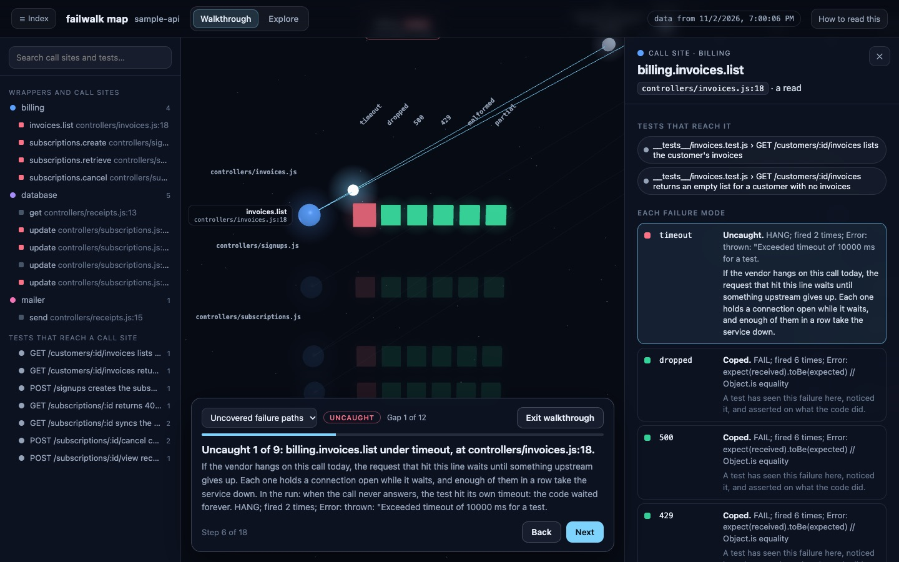
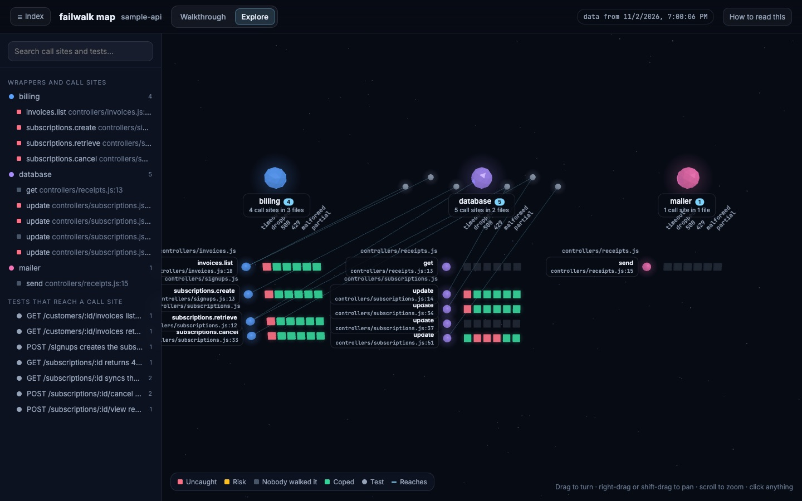

# failwalk

Failure-mode coverage for dependency calls.

Line coverage says your code called the billing vendor. It says nothing about what the code does when that call fails. Failwalk finds every place your code calls a vendor or database through a wrapper module, records which tests reach each place, then runs those tests with one failure injected at a time and reports what happened.

This is v1, steps 1 to 5 of the build order in [SPEC.md](SPEC.md): the inventory, the tracer, the failure-mode table, the grid of every call site against every failure mode, filled by one command, and the five static checks that turn a PASS into a RISK.

## What is here

| Piece | What it does |
| --- | --- |
| `failwalk inventory` | Parses your source with Babel and lists every call into a wrapper module as a JSON record. |
| The static checks | Five patterns read off the code around each call site at inventory time: a retried write with no idempotency key, no timeout, a swallowed catch, a retry with no backoff, a dropped promise. |
| The tracer setup file | Loaded by Jest. Wraps every wrapper function and records which test reached which call site. Writes one record per test file. |
| `failwalk trace` | Merges those records into `failwalk-trace.json` and prints who reached what. |
| `FAILWALK_SITE` + `FAILWALK_MODE` | Make exactly one call site fail the way one row of the mode table says. Every other call runs the real wrapper. |
| The mode table | Six failure modes: `timeout`, `dropped`, `500`, `429`, `malformed`, `partial`. |
| `failwalk plan` | Builds one cell per (call site, mode) from the inventory and the trace, with the tests to run for each. |
| `failwalk run` | Inventory, traced baseline, plan, then one runner process per cell through a bounded pool, a verdict per cell, `RISK` where a check fired on a passing cell, `failwalk.json` and the terminal grid. |
| `failwalk ui` | Draws the grid as a 3D map in one self-contained HTML page and opens it. Red, amber and grey cells are the failure paths nobody has walked. |
| `examples/sample-api` | A small Express app with three wrapper modules and its own Jest suite, including one route per static check. The target for the output below. |

Failwalk runs inside your test suite. It never touches a deployed environment.

## Install

Node 20 or newer. Developed on Node 24.

```bash
npm install
```

```bash
npm run build
```

`npm test` builds, runs failwalk's own tests, then runs the sample app's suite.

To see the whole thing at once:

```bash
node dist/cli.js run --root examples/sample-api --wrappers "config/**/*.js"
```

The steps below show what each stage does on its own.

## Step 1: inventory

Point it at a project root and a glob for the wrapper modules. Every call through one of those modules becomes a record. Test files are left out: a test calling a wrapper is not a call site that needs protecting.

```bash
node dist/cli.js inventory --root examples/sample-api --wrappers "config/**/*.js"
```

Records go to stdout. The summary goes to stderr. The full inventory, which the tracer reads, goes to `failwalk-inventory.json`.

```
failwalk inventory: 15 call sites in 9 files, 3 of 3 wrappers used
  database                         7
  billing                          6
  mailer                           2
9 static checks fired:
  swallowed-catch                billing.invoices.list@controllers/invoices.js:18
  retry-without-backoff          billing.invoices.list@controllers/invoices.js:18
  no-timeout                     mailer.send@controllers/noTimeout.js:15
  no-timeout                     mailer.send@controllers/receipts.js:15
  retry-without-backoff          billing.subscriptions.retrieve@controllers/retryWithoutBackoff.js:20
  retry-without-idempotency-key  billing.subscriptions.create@controllers/retryWithoutKey.js:25
  unawaited-call                 database.update@controllers/subscriptions.js:51
  swallowed-catch                database.remove@controllers/swallowedCatch.js:16
  unawaited-call                 database.update@controllers/unawaitedCall.js:14
written to /Users/patrickfinazzo/Desktop/dependency-failure-coverage/failwalk-inventory.json
```

Two of the fifteen records:

```json
{
  "id": "billing.subscriptions.retrieve@controllers/subscriptions.js:12",
  "file": "controllers/subscriptions.js",
  "line": 12,
  "wrapper": "billing",
  "method": "subscriptions.retrieve",
  "kind": "read",
  "checks": [],
  "notes": []
},
{
  "id": "database.update@controllers/subscriptions.js:51",
  "file": "controllers/subscriptions.js",
  "line": 51,
  "wrapper": "database",
  "method": "update",
  "kind": "write",
  "checks": ["unawaited-call"],
  "notes": []
}
```

How each field is found:

- `wrapper` is the module's path under the wrapper folder. `config/billing.js` is `billing`. `config/db/index.js` would be `db`.
- `method` is the whole member chain after the wrapper: `subscriptions.retrieve` for `billing.subscriptions.retrieve(...)`. A destructured `const { get } = require("../config/database")` gives `get`.
- `line` is the line of the method name, which is the line a stack trace reports.
- `kind` is `read` when the last segment of `method` is a read verb (`get`, `retrieve`, `list`, `find`, `fetch`, `query`, `exists`, and a few more), or starts with one followed by a capital letter (`getUser`). Everything else is `write`, the safer assumption.
- `checks` lists the static checks that fired on the call, in table order. `notes` lists shapes the checks saw but cannot judge. Both are empty when there is nothing to say. Step 5 explains them.

The inventory understands `require`, destructured `require`, `require(...).member`, and ES module imports in every form: default, named, renamed and namespace. A local name that shadows an import is not counted.

## Step 2: trace

The tracer is a Jest setup file. Add it through a config override, so the project's own config stays untouched. The sample app's override is [examples/sample-api/jest.failwalk.config.js](examples/sample-api/jest.failwalk.config.js):

```js
const path = require("node:path");
const base = require("./jest.config");

const setupFile = process.env.FAILWALK_SETUP || path.resolve(__dirname, "../../dist/tracer/setup.js");

module.exports = { ...base, setupFilesAfterEnv: [...(base.setupFilesAfterEnv || []), setupFile] };
```

Run the suite with that config from the folder that holds `failwalk-inventory.json`:

```bash
npx jest --config examples/sample-api/jest.failwalk.config.js
```

```
Test Suites: 9 passed, 9 total
Tests:       14 passed, 14 total
```

Without an injection the tracer changes no result. It only records. Each test file writes one record into `.failwalk/trace/`. Merge them:

```bash
node dist/cli.js trace
```

```
failwalk trace: 14 tests in 9 files reached 12 of 15 call sites. 3 UNREACHED, 4 UNINVENTORIED.

billing.invoices.list@controllers/invoices.js:18   2 tests
    __tests__/invoices.test.js › GET /customers/:id/invoices lists the customer's invoices
    __tests__/invoices.test.js › GET /customers/:id/invoices returns an empty list for a customer with no invoices
billing.subscriptions.cancel@controllers/subscriptions.js:33   1 test
    __tests__/subscriptions.test.js › POST /subscriptions/:id/cancel cancels at billing and reports the new status
billing.subscriptions.create@controllers/retryWithoutKey.js:25   1 test
    __tests__/retryWithoutKey.test.js › POST /signups/retrying answers 201 once the vendor has the subscription
billing.subscriptions.create@controllers/signups.js:13   1 test
    __tests__/signups.test.js › POST /signups creates the subscription at billing and returns it
billing.subscriptions.retrieve@controllers/retryWithoutBackoff.js:20   1 test
    __tests__/retryWithoutBackoff.test.js › GET /subscriptions/:id/status reads the status from billing
billing.subscriptions.retrieve@controllers/subscriptions.js:12   2 tests
    __tests__/subscriptions.test.js › GET /subscriptions/:id returns 404 for a subscription billing does not know
    __tests__/subscriptions.test.js › GET /subscriptions/:id syncs the subscription from billing and returns it
database.remove@controllers/swallowedCatch.js:16   1 test
    __tests__/swallowedCatch.test.js › DELETE /subscriptions/:id reports the subscription archived
database.update@controllers/subscriptions.js:14   1 test
    __tests__/subscriptions.test.js › GET /subscriptions/:id syncs the subscription from billing and returns it
database.update@controllers/subscriptions.js:34   1 test
    __tests__/subscriptions.test.js › POST /subscriptions/:id/cancel cancels at billing and reports the new status
database.update@controllers/subscriptions.js:51   1 test
    __tests__/subscriptions.test.js › POST /subscriptions/:id/view records the view
database.update@controllers/unawaitedCall.js:14   1 test
    __tests__/unawaitedCall.test.js › POST /subscriptions/:id/login records the login
mailer.send@controllers/noTimeout.js:15   1 test
    __tests__/noTimeout.test.js › POST /welcome queues the welcome email and answers 202

UNREACHED (no test reaches these):
    database.get@controllers/receipts.js:13
    mailer.send@controllers/receipts.js:15
    database.update@controllers/subscriptions.js:37

UNINVENTORIED (the tracer saw these, the inventory did not):
    database.get at __tests__/database.test.js:12
        __tests__/database.test.js › database wrapper update merges fields into a record
    database.get at __tests__/database.test.js:6
        __tests__/database.test.js › database wrapper reads a missing record as null
    database.update at __tests__/database.test.js:10
        __tests__/database.test.js › database wrapper update merges fields into a record
    database.update at __tests__/database.test.js:11
        __tests__/database.test.js › database wrapper update merges fields into a record
written to /Users/patrickfinazzo/Desktop/dependency-failure-coverage/failwalk-trace.json
```

Reading this:

- **Reached sites** list the tests that got there. These are the tests an injection run will use.
- **UNREACHED** sites have no test. Two are the receipt route, which no test calls. The third is line 37, the database write inside the `catch` of `cancelSubscription`. No test makes the billing cancel fail, so the catch never runs. Failwalk only runs the tests you have, so these sites stay UNREACHED in every column of the grid until someone writes a test that reaches them.
- **UNINVENTORIED** calls were made by the tests themselves. The inventory skips test files, the tracer does not. A call the tracer sees but the inventory does not is always reported, never dropped. Each one carries its file and line.

`failwalk-trace.json` holds the same data as JSON: `tests` (each test and the site ids it reached), `sites` (each id and the tests that reached it), `unreached`, `UNINVENTORIED` and `injection`.

How matching works: every wrapped method captures a stack trace when called. The first frame outside `node_modules`, outside the tracer, and outside the wrapper files is the caller. Its file and line, after Jest's source-map resolution, are looked up in the inventory. On a line with several sites, the one with the same wrapper and method wins.

## Step 3: one injected failure

Pick a reached call site and set two environment variables: the site id and a mode from the table in step 4. The tracer makes that one site fail the way the mode says. The same wrapper method called from any other line keeps running for real. This section uses `500`, which rejects with a vendor-shaped 500 error.

The chosen site is line 51 of `controllers/subscriptions.js`, where `recordView` writes to the database without awaiting the promise:

```js
const recordView = ({ subscriptionId }) => {
  database.update({ path: `subscriptions/${subscriptionId}`, value: { viewed_at: Date.now() } });
  return { recorded: true };
};
```

Baseline, no injection:

```bash
npx jest --config examples/sample-api/jest.config.js subscriptions
```

```
Test Suites: 1 passed, 1 total
Tests:       4 passed, 4 total
```

The same tests with the 500 injected at that site:

```bash
FAILWALK_SITE="database.update@controllers/subscriptions.js:51" FAILWALK_MODE=500 npx jest --config examples/sample-api/jest.failwalk.config.js subscriptions
```

```
FAIL examples/sample-api/__tests__/subscriptions.test.js
  ● POST /subscriptions/:id/view › records the view

    FailwalkInjectedError: database.update failed with HTTP 500 (injected by failwalk at database.update@controllers/subscriptions.js:51)

      at update (controllers/subscriptions.js:51:12)
      at recordView (app.js:24:60)

Test Suites: 1 failed, 1 total
Tests:       1 failed, 3 passed, 4 total
```

| Cell | Mode | Result |
| --- | --- | --- |
| `database.update@controllers/subscriptions.js:51` | 500 | **CRASH** |

This is a CRASH, not a FAIL. No assertion failed. The route answered 200 and the test's expectations all held. The injected error surfaced on its own as an unhandled rejection, which Jest pinned on the test that was running. In production, nothing would catch it. The trace record for the run shows the injection fired exactly once:

```json
"injection": {
  "site": "database.update@controllers/subscriptions.js:51",
  "mode": "500",
  "fired": 1
}
```

For contrast, the same mode at line 33, the billing cancel inside a `try/catch`:

```bash
FAILWALK_SITE="billing.subscriptions.cancel@controllers/subscriptions.js:33" FAILWALK_MODE=500 npx jest --config examples/sample-api/jest.failwalk.config.js subscriptions
```

```
  ● POST /subscriptions/:id/cancel › cancels at billing and reports the new status

    expect(received).toBe(expected) // Object.is equality

    Expected: 200
    Received: 202
```

| Cell | Mode | Result |
| --- | --- | --- |
| `billing.subscriptions.cancel@controllers/subscriptions.js:33` | 500 | **FAIL** |

A FAIL is the good outcome. The code noticed the vendor failure, marked the record `cancel_pending`, answered 202, and a test caught the difference. The two outcomes are told apart by what Jest reports: an assertion failure is FAIL, the injected error itself is CRASH.

One more contrast, at line 18 inside the retry loop of `listInvoices`: the injection fires on every attempt, three per test, six in all, and the route answers 502. Step 4 does this classification for every site and every mode.

## Step 4: the grid

### The mode table

Each mode is one row in [src/tracer/modes.ts](src/tracer/modes.ts), keyed by name. A row says what the injected call does instead of reaching the vendor. `FAILWALK_MODE` accepts every row.

| Mode | What the injected call does |
| --- | --- |
| `timeout` | Never settles. The test's own timeout ends it. |
| `dropped` | Rejects with an error whose `code` is `ECONNRESET`. |
| `500` | Rejects with a vendor-shaped error carrying status 500. |
| `429` | Rejects with a vendor-shaped error carrying status 429. |
| `malformed` | Resolves with `{}`. |
| `partial` | Calls the vendor, then resolves with the first half of an array result, or `{}` for anything else. |

The spec's `duplicate` mode is for inbound webhooks and is v2 work.

### The plan

The plan is a pure function from the inventory and the trace: one cell per (call site, mode). A cell lists the tests that reached its site in the baseline. Those are the only tests the injection run needs. A site no test reached gets an empty list and the verdict `UNREACHED`, and nothing runs for it. That is what keeps a run short.

```bash
node dist/cli.js plan --root examples/sample-api
```

```
failwalk plan: 90 cells (12 reached sites × 6 modes). 72 to run, 18 UNREACHED.
```

`failwalk-plan.json` holds the cells. One of them:

```json
{
  "site": "billing.invoices.list@controllers/invoices.js:18",
  "wrapper": "billing",
  "mode": "500",
  "tests": [
    {
      "testPath": "/Users/patrickfinazzo/Desktop/dependency-failure-coverage/examples/sample-api/__tests__/invoices.test.js",
      "file": "__tests__/invoices.test.js",
      "name": "GET /customers/:id/invoices lists the customer's invoices"
    },
    {
      "testPath": "/Users/patrickfinazzo/Desktop/dependency-failure-coverage/examples/sample-api/__tests__/invoices.test.js",
      "file": "__tests__/invoices.test.js",
      "name": "GET /customers/:id/invoices returns an empty list for a customer with no invoices"
    }
  ],
  "verdict": null
}
```

The plan command checks that the inventory in the current folder was made for `--root`, so a stale inventory from another project cannot be planned by mistake.

### The run

```bash
node dist/cli.js run --root examples/sample-api --wrappers "config/**/*.js"
```

This does the inventory, runs the suite once with the tracer loaded, builds the plan, then starts one runner process per planned cell. Each process is filtered to exactly that cell's test files and test names, gets `FAILWALK_SITE` and `FAILWALK_MODE` for the cell, and writes its JSON results and trace records into its own folder under `.failwalk/`. Nothing is shared between cells.

The processes go through a bounded pool, four at a time by default. `--concurrency N` changes that. A pool, not a queue: a cell whose test hangs for ten seconds does not hold the others up.

Failwalk gives every runner process a per-test timeout of its own, ten seconds by default, `--test-timeout-ms` to change it. That is what turns a `timeout` injection on a call with no timeout of its own into a `HANG` verdict instead of a run that never ends. The runner is also told to exit once its results are written, so a request left waiting on a hung vendor call cannot keep the process alive.

Progress lines go to stderr as cells finish. The table and the headline go to stdout, the headline last.

The grid below is from the end of step 4, when the sample app had ten call sites. On this laptop that run took 26 seconds. Step 5 adds five call sites to the sample app and shows the grid as it is now.

```
billing   24 cells: 4 HANG, 20 FAIL
  HANG      timeout   billing.invoices.list@controllers/invoices.js:18   fired 2; Error: thrown: "Exceeded timeout of 10000 ms for a test.
  HANG      timeout   billing.subscriptions.create@controllers/signups.js:13   fired 1; Error: thrown: "Exceeded timeout of 10000 ms for a test.
  HANG      timeout   billing.subscriptions.retrieve@controllers/subscriptions.js:12   fired 2; Error: thrown: "Exceeded timeout of 10000 ms for a test.
  HANG      timeout   billing.subscriptions.cancel@controllers/subscriptions.js:33   fired 1; Error: thrown: "Exceeded timeout of 10000 ms for a test.
  FAIL      dropped   billing.invoices.list@controllers/invoices.js:18   fired 6; Error: expect(received).toBe(expected) // Object.is equality
  FAIL      500       billing.invoices.list@controllers/invoices.js:18   fired 6; Error: expect(received).toBe(expected) // Object.is equality
  FAIL      429       billing.invoices.list@controllers/invoices.js:18   fired 6; Error: expect(received).toBe(expected) // Object.is equality
  FAIL      malformed billing.invoices.list@controllers/invoices.js:18   fired 2; Error: expect(received).toEqual(expected) // deep equality
  FAIL      partial   billing.invoices.list@controllers/invoices.js:18   fired 2; Error: expect(received).toEqual(expected) // deep equality
  FAIL      dropped   billing.subscriptions.create@controllers/signups.js:13   fired 1; Error: expect(received).toBe(expected) // Object.is equality
  FAIL      500       billing.subscriptions.create@controllers/signups.js:13   fired 1; Error: expect(received).toBe(expected) // Object.is equality
  FAIL      429       billing.subscriptions.create@controllers/signups.js:13   fired 1; Error: expect(received).toBe(expected) // Object.is equality
  FAIL      malformed billing.subscriptions.create@controllers/signups.js:13   fired 1; Error: expect(received).toEqual(expected) // deep equality
  FAIL      partial   billing.subscriptions.create@controllers/signups.js:13   fired 1; Error: expect(received).toEqual(expected) // deep equality
  FAIL      dropped   billing.subscriptions.retrieve@controllers/subscriptions.js:12   fired 2; Error: expect(received).toBe(expected) // Object.is equality
  FAIL      500       billing.subscriptions.retrieve@controllers/subscriptions.js:12   fired 2; Error: expect(received).toBe(expected) // Object.is equality
  FAIL      429       billing.subscriptions.retrieve@controllers/subscriptions.js:12   fired 2; Error: expect(received).toBe(expected) // Object.is equality
  FAIL      malformed billing.subscriptions.retrieve@controllers/subscriptions.js:12   fired 2; Error: expect(received).toBe(expected) // Object.is equality
  FAIL      partial   billing.subscriptions.retrieve@controllers/subscriptions.js:12   fired 2; Error: expect(received).toBe(expected) // Object.is equality
  FAIL      dropped   billing.subscriptions.cancel@controllers/subscriptions.js:33   fired 1; Error: expect(received).toBe(expected) // Object.is equality
  FAIL      500       billing.subscriptions.cancel@controllers/subscriptions.js:33   fired 1; Error: expect(received).toBe(expected) // Object.is equality
  FAIL      429       billing.subscriptions.cancel@controllers/subscriptions.js:33   fired 1; Error: expect(received).toBe(expected) // Object.is equality
  FAIL      malformed billing.subscriptions.cancel@controllers/subscriptions.js:33   fired 1; Error: expect(received).toBe(expected) // Object.is equality
  FAIL      partial   billing.subscriptions.cancel@controllers/subscriptions.js:33   fired 1; Error: expect(received).toBe(expected) // Object.is equality

database   30 cells: 3 CRASH, 2 HANG, 6 FAIL, 7 PASS, 12 UNREACHED
  CRASH     dropped   database.update@controllers/subscriptions.js:51   fired 1; FailwalkInjectedError: database.update connection reset (injected by failwalk at database.
  CRASH     500       database.update@controllers/subscriptions.js:51   fired 1; FailwalkInjectedError: database.update failed with HTTP 500 (injected by failwalk at datab
  CRASH     429       database.update@controllers/subscriptions.js:51   fired 1; FailwalkInjectedError: database.update failed with HTTP 429 (injected by failwalk at datab
  HANG      timeout   database.update@controllers/subscriptions.js:14   fired 1; Error: thrown: "Exceeded timeout of 10000 ms for a test.
  HANG      timeout   database.update@controllers/subscriptions.js:34   fired 1; Error: thrown: "Exceeded timeout of 10000 ms for a test.
  FAIL      dropped   database.update@controllers/subscriptions.js:14   fired 1; Error: expect(received).toBe(expected) // Object.is equality
  FAIL      500       database.update@controllers/subscriptions.js:14   fired 1; Error: expect(received).toBe(expected) // Object.is equality
  FAIL      429       database.update@controllers/subscriptions.js:14   fired 1; Error: expect(received).toBe(expected) // Object.is equality
  FAIL      dropped   database.update@controllers/subscriptions.js:34   fired 1; Error: expect(received).toBe(expected) // Object.is equality
  FAIL      500       database.update@controllers/subscriptions.js:34   fired 1; Error: expect(received).toBe(expected) // Object.is equality
  FAIL      429       database.update@controllers/subscriptions.js:34   fired 1; Error: expect(received).toBe(expected) // Object.is equality
  PASS      malformed database.update@controllers/subscriptions.js:14   fired 1
  PASS      partial   database.update@controllers/subscriptions.js:14   fired 1
  PASS      malformed database.update@controllers/subscriptions.js:34   fired 1
  PASS      partial   database.update@controllers/subscriptions.js:34   fired 1
  PASS      timeout   database.update@controllers/subscriptions.js:51   fired 1
  PASS      malformed database.update@controllers/subscriptions.js:51   fired 1
  PASS      partial   database.update@controllers/subscriptions.js:51   fired 1
  UNREACHED timeout   database.get@controllers/receipts.js:13
  UNREACHED dropped   database.get@controllers/receipts.js:13
  UNREACHED 500       database.get@controllers/receipts.js:13
  UNREACHED 429       database.get@controllers/receipts.js:13
  UNREACHED malformed database.get@controllers/receipts.js:13
  UNREACHED partial   database.get@controllers/receipts.js:13
  UNREACHED timeout   database.update@controllers/subscriptions.js:37
  UNREACHED dropped   database.update@controllers/subscriptions.js:37
  UNREACHED 500       database.update@controllers/subscriptions.js:37
  UNREACHED 429       database.update@controllers/subscriptions.js:37
  UNREACHED malformed database.update@controllers/subscriptions.js:37
  UNREACHED partial   database.update@controllers/subscriptions.js:37

mailer   6 cells: 6 UNREACHED
  UNREACHED timeout   mailer.send@controllers/receipts.js:15
  UNREACHED dropped   mailer.send@controllers/receipts.js:15
  UNREACHED 500       mailer.send@controllers/receipts.js:15
  UNREACHED 429       mailer.send@controllers/receipts.js:15
  UNREACHED malformed mailer.send@controllers/receipts.js:15
  UNREACHED partial   mailer.send@controllers/receipts.js:15

failwalk: 10 call sites, 6 modes, 60 cells. 33 covered (55%). 3 CRASH, 6 HANG, 26 FAIL, 18 UNREACHED.
```

Cells are grouped by wrapper. Inside a wrapper, CRASH rows come first, then HANG, RISK (from step 5), FAIL, PASS and UNREACHED. Each row names the verdict, the mode, the site id, how many times the injection fired, and the first line of the first failure.

### The verdicts

One lookup table in [src/verdicts.ts](src/verdicts.ts) turns what a runner process did into a verdict. The rows are tested in order and the first match wins.

| Verdict | When |
| --- | --- |
| `CRASH` | The runner wrote no results, or a planned test failed with something other than an assertion: the injected error itself, a `TypeError`, an unhandled rejection. Or the runner reported nothing for a planned test. |
| `HANG` | A planned test was ended by the runner's timeout. |
| `FAIL` | A planned test failed on an assertion. The runner's message starts with `expect(` or contains `Expected:`. |
| `RISK` | Every planned test passed, but a static check fired on the site. Step 5. |
| `PASS` | Every planned test passed, and no check fired. |
| `UNREACHED` | No test reached the site. Nothing ran. |

Reading the sample grid:

- **The floating write at line 51** is CRASH under `dropped`, `500` and `429`. Nothing awaits that `database.update`, so the injected rejection surfaces on its own and the runner pins it on the test. Under `timeout` the same line is PASS: the promise never settles, nothing waits for it, and the test is none the wiser. That PASS is the double-charge class the spec's `RISK` verdict exists for. Step 5 adds the static check that finds it, and the same cell is RISK in the grid there.
- **Every awaited vendor call** is HANG under `timeout`. None of these calls has a timeout of its own, so the request waits until the runner's timeout ends the test. The retry loop at `invoices.js:18` fires twice, once per test: the first attempt hangs, so there is no second attempt.
- **FAIL is the good outcome.** The cancel inside `try/catch` at line 33 marks the record `cancel_pending`, answers 202, and the test notices. The retry loop at line 18 gives up after three attempts, six injections over two tests, and answers 502. Under `malformed` and `partial`, the invoices route hands the test the wrong list and `toEqual` catches it.
- **PASS under `malformed` and `partial`** at lines 14 and 34 means the code ignores what the database write returns. Fine for a write whose result nobody reads.
- **UNREACHED** is the receipt route and the catch path. No test, no column.

The sample app gained one call site for this step, `billing.subscriptions.create` in [examples/sample-api/controllers/signups.js](examples/sample-api/controllers/signups.js): an awaited vendor call whose test asserts on the answer, so it is HANG under `timeout` and FAIL under `malformed`.

### Exit code

`failwalk run` exits 1 when the covered fraction is below `--min-coverage`, a number from 0 to 1 that defaults to 0. Covered means PASS or FAIL. CRASH cells alone never fail the run; the number does.

```bash
node dist/cli.js run --root examples/sample-api --wrappers "config/**/*.js" --min-coverage 0.6
```

exits 1 on the grid above, since 33 of 60 is 55%. It exits 1 on the current grid in step 5 too: 43 of 90 is 48%, because RISK cells are not covered.

### `failwalk.json`

The source of truth for a run. It holds the inventory, the merged trace, the plan, and every cell with its verdict, the tests it ran, and what the runner did. The `timeout` cell for the signup call:

```json
{
  "site": "billing.subscriptions.create@controllers/signups.js:13",
  "wrapper": "billing",
  "mode": "timeout",
  "verdict": "HANG",
  "evidence": {
    "ran": true,
    "exitCode": 1,
    "fired": 1,
    "tests": [
      {
        "file": "__tests__/signups.test.js",
        "name": "POST /signups creates the subscription at billing and returns it",
        "outcome": "timeout",
        "message": "Error: thrown: \"Exceeded timeout of 10000 ms for a test. ..."
      }
    ],
    "runnerErrors": [],
    "durationMs": 10302
  }
}
```

`failwalk-inventory.json`, `failwalk-trace.json` and `failwalk-plan.json` are written beside it, and every runner process's JSON results and trace records stay under `.failwalk/`, one folder per cell, for reading after the run.

## Step 5: RISK

A PASS says the tests passed with the failure injected. It does not say the code handled the failure. The test may never look at the thing that broke. Five static checks read the code around each call site while the inventory is built. When a check fires on a site, every PASS cell of that site becomes RISK, and the cell names the checks.

### The check table

One lookup table in [src/inventory/staticChecks.ts](src/inventory/staticChecks.ts), keyed by name. Each row is a sentence on what it finds and a pure function from the call and its surroundings to true or false. Adding a check means adding a row.

| Check | Fires when |
| --- | --- |
| `retry-without-idempotency-key` | The call is inside a retry, its `kind` is `write`, and no argument carries a property or header named `idempotency_key`, `idempotencyKey` or `Idempotency-Key`. |
| `no-timeout` | No argument carries a property named `timeout`, `timeoutMs` or `timeout_ms`, and the wrapper names none of those for the method: not in the method's own definition, and not at module level, where a limit shared by every method lives. |
| `swallowed-catch` | The call sits in the block of a `try` whose `catch` has no `throw`, no `return` with a value, and no `Promise.reject`. A call inside the `catch` itself does not count, and neither does `try`/`finally`. |
| `retry-without-backoff` | The call is inside a retry, and the loop body or callback awaits nothing that is, or contains, a call named like `sleep`, `delay`, `wait` or `setTimeout`. `await new Promise((resolve) => setTimeout(resolve, ms))` counts as a wait. |
| `unawaited-call` | The call's promise is not awaited, returned, assigned to a variable or property, passed as an argument or an array element, nor followed by `.then` or `.catch`. |

"Inside a retry" means one of two shapes: the body of a `for`, `while` or `do` loop that contains a `try`/`catch`, or a callback passed to a call named `retry`, `pRetry`, `withRetry` or `retryAsync`. A third shape, a function that calls itself from inside its own `catch`, is not judged. Every call site in such a function gets `retry-shape-unknown` in its `notes`, so the report can say the shape was seen.

### In the inventory

`failwalk inventory` adds one line per fired check to its summary: the check name, then the site id.

```bash
node dist/cli.js inventory --root examples/sample-api --wrappers "config/**/*.js"
```

```
failwalk inventory: 15 call sites in 9 files, 3 of 3 wrappers used
  database                         7
  billing                          6
  mailer                           2
9 static checks fired:
  swallowed-catch                billing.invoices.list@controllers/invoices.js:18
  retry-without-backoff          billing.invoices.list@controllers/invoices.js:18
  no-timeout                     mailer.send@controllers/noTimeout.js:15
  no-timeout                     mailer.send@controllers/receipts.js:15
  retry-without-backoff          billing.subscriptions.retrieve@controllers/retryWithoutBackoff.js:20
  retry-without-idempotency-key  billing.subscriptions.create@controllers/retryWithoutKey.js:25
  unawaited-call                 database.update@controllers/subscriptions.js:51
  swallowed-catch                database.remove@controllers/swallowedCatch.js:16
  unawaited-call                 database.update@controllers/unawaitedCall.js:14
written to /Users/patrickfinazzo/Desktop/dependency-failure-coverage/failwalk-inventory.json
```

Nine checks fire on eight sites. Five of those sites were added for this step, one per check, each in its own controller named for the pattern. The other three were there already: the retry loop in `listInvoices` has no wait between attempts and its `catch` only stores the error, the write in `recordView` was never awaited, and the receipt route's mailer call has no time limit. The mailer wrapper has none at all, so both calls into it fire `no-timeout`. The billing and database wrappers set one limit for every method at module level, so none of their calls do.

### The verdict

One row joins the verdict table in [src/verdicts.ts](src/verdicts.ts), after FAIL and before PASS: a cell whose tests all passed, and whose site has at least one fired check, is RISK. CRASH, HANG and FAIL are decided first, so a check never hides a failure the tests caught. RISK is not counted as covered. The tests passed, but the pattern the check found is what they did not test.

### The grid

```bash
node dist/cli.js run --root examples/sample-api --wrappers "config/**/*.js"
```

On this laptop the run took 40 seconds.

```
billing   36 cells: 6 HANG, 2 RISK, 28 FAIL
  HANG      timeout   billing.invoices.list@controllers/invoices.js:18   fired 2; Error: thrown: "Exceeded timeout of 10000 ms for a test.
  HANG      timeout   billing.subscriptions.retrieve@controllers/retryWithoutBackoff.js:20   fired 1; Error: thrown: "Exceeded timeout of 10000 ms for a test.
  HANG      timeout   billing.subscriptions.create@controllers/retryWithoutKey.js:25   fired 1; Error: thrown: "Exceeded timeout of 10000 ms for a test.
  HANG      timeout   billing.subscriptions.create@controllers/signups.js:13   fired 1; Error: thrown: "Exceeded timeout of 10000 ms for a test.
  HANG      timeout   billing.subscriptions.retrieve@controllers/subscriptions.js:12   fired 2; Error: thrown: "Exceeded timeout of 10000 ms for a test.
  HANG      timeout   billing.subscriptions.cancel@controllers/subscriptions.js:33   fired 1; Error: thrown: "Exceeded timeout of 10000 ms for a test.
  RISK      malformed billing.subscriptions.create@controllers/retryWithoutKey.js:25   fired 1; checks: retry-without-idempotency-key
  RISK      partial   billing.subscriptions.create@controllers/retryWithoutKey.js:25   fired 1; checks: retry-without-idempotency-key
  FAIL      dropped   billing.invoices.list@controllers/invoices.js:18   fired 6; Error: expect(received).toBe(expected) // Object.is equality
  FAIL      500       billing.invoices.list@controllers/invoices.js:18   fired 6; Error: expect(received).toBe(expected) // Object.is equality
  FAIL      429       billing.invoices.list@controllers/invoices.js:18   fired 6; Error: expect(received).toBe(expected) // Object.is equality
  FAIL      malformed billing.invoices.list@controllers/invoices.js:18   fired 2; Error: expect(received).toEqual(expected) // deep equality
  FAIL      partial   billing.invoices.list@controllers/invoices.js:18   fired 2; Error: expect(received).toEqual(expected) // deep equality
  FAIL      dropped   billing.subscriptions.retrieve@controllers/retryWithoutBackoff.js:20   fired 3; Error: expect(received).toBe(expected) // Object.is equality
  FAIL      500       billing.subscriptions.retrieve@controllers/retryWithoutBackoff.js:20   fired 3; Error: expect(received).toBe(expected) // Object.is equality
  FAIL      429       billing.subscriptions.retrieve@controllers/retryWithoutBackoff.js:20   fired 3; Error: expect(received).toBe(expected) // Object.is equality
  FAIL      malformed billing.subscriptions.retrieve@controllers/retryWithoutBackoff.js:20   fired 1; Error: expect(received).toEqual(expected) // deep equality
  FAIL      partial   billing.subscriptions.retrieve@controllers/retryWithoutBackoff.js:20   fired 1; Error: expect(received).toEqual(expected) // deep equality
  FAIL      dropped   billing.subscriptions.create@controllers/retryWithoutKey.js:25   fired 3; Error: expect(received).toBe(expected) // Object.is equality
  FAIL      500       billing.subscriptions.create@controllers/retryWithoutKey.js:25   fired 3; Error: expect(received).toBe(expected) // Object.is equality
  FAIL      429       billing.subscriptions.create@controllers/retryWithoutKey.js:25   fired 3; Error: expect(received).toBe(expected) // Object.is equality
  FAIL      dropped   billing.subscriptions.create@controllers/signups.js:13   fired 1; Error: expect(received).toBe(expected) // Object.is equality
  FAIL      500       billing.subscriptions.create@controllers/signups.js:13   fired 1; Error: expect(received).toBe(expected) // Object.is equality
  FAIL      429       billing.subscriptions.create@controllers/signups.js:13   fired 1; Error: expect(received).toBe(expected) // Object.is equality
  FAIL      malformed billing.subscriptions.create@controllers/signups.js:13   fired 1; Error: expect(received).toEqual(expected) // deep equality
  FAIL      partial   billing.subscriptions.create@controllers/signups.js:13   fired 1; Error: expect(received).toEqual(expected) // deep equality
  FAIL      dropped   billing.subscriptions.retrieve@controllers/subscriptions.js:12   fired 2; Error: expect(received).toBe(expected) // Object.is equality
  FAIL      500       billing.subscriptions.retrieve@controllers/subscriptions.js:12   fired 2; Error: expect(received).toBe(expected) // Object.is equality
  FAIL      429       billing.subscriptions.retrieve@controllers/subscriptions.js:12   fired 2; Error: expect(received).toBe(expected) // Object.is equality
  FAIL      malformed billing.subscriptions.retrieve@controllers/subscriptions.js:12   fired 2; Error: expect(received).toBe(expected) // Object.is equality
  FAIL      partial   billing.subscriptions.retrieve@controllers/subscriptions.js:12   fired 2; Error: expect(received).toBe(expected) // Object.is equality
  FAIL      dropped   billing.subscriptions.cancel@controllers/subscriptions.js:33   fired 1; Error: expect(received).toBe(expected) // Object.is equality
  FAIL      500       billing.subscriptions.cancel@controllers/subscriptions.js:33   fired 1; Error: expect(received).toBe(expected) // Object.is equality
  FAIL      429       billing.subscriptions.cancel@controllers/subscriptions.js:33   fired 1; Error: expect(received).toBe(expected) // Object.is equality
  FAIL      malformed billing.subscriptions.cancel@controllers/subscriptions.js:33   fired 1; Error: expect(received).toBe(expected) // Object.is equality
  FAIL      partial   billing.subscriptions.cancel@controllers/subscriptions.js:33   fired 1; Error: expect(received).toBe(expected) // Object.is equality

mailer   12 cells: 1 HANG, 5 FAIL, 6 UNREACHED
  HANG      timeout   mailer.send@controllers/noTimeout.js:15   fired 1; Error: thrown: "Exceeded timeout of 10000 ms for a test.
  FAIL      dropped   mailer.send@controllers/noTimeout.js:15   fired 1; Error: expect(received).toBe(expected) // Object.is equality
  FAIL      500       mailer.send@controllers/noTimeout.js:15   fired 1; Error: expect(received).toBe(expected) // Object.is equality
  FAIL      429       mailer.send@controllers/noTimeout.js:15   fired 1; Error: expect(received).toBe(expected) // Object.is equality
  FAIL      malformed mailer.send@controllers/noTimeout.js:15   fired 1; Error: expect(received).toBe(expected) // Object.is equality
  FAIL      partial   mailer.send@controllers/noTimeout.js:15   fired 1; Error: expect(received).toBe(expected) // Object.is equality
  UNREACHED timeout   mailer.send@controllers/receipts.js:15
  UNREACHED dropped   mailer.send@controllers/receipts.js:15
  UNREACHED 500       mailer.send@controllers/receipts.js:15
  UNREACHED 429       mailer.send@controllers/receipts.js:15
  UNREACHED malformed mailer.send@controllers/receipts.js:15
  UNREACHED partial   mailer.send@controllers/receipts.js:15

database   42 cells: 6 CRASH, 3 HANG, 11 RISK, 6 FAIL, 4 PASS, 12 UNREACHED
  CRASH     dropped   database.update@controllers/subscriptions.js:51   fired 1; FailwalkInjectedError: database.update connection reset (injected by failwalk at database.
  CRASH     500       database.update@controllers/subscriptions.js:51   fired 1; FailwalkInjectedError: database.update failed with HTTP 500 (injected by failwalk at datab
  CRASH     429       database.update@controllers/subscriptions.js:51   fired 1; FailwalkInjectedError: database.update failed with HTTP 429 (injected by failwalk at datab
  CRASH     dropped   database.update@controllers/unawaitedCall.js:14   fired 1; FailwalkInjectedError: database.update connection reset (injected by failwalk at database.
  CRASH     500       database.update@controllers/unawaitedCall.js:14   fired 1; FailwalkInjectedError: database.update failed with HTTP 500 (injected by failwalk at datab
  CRASH     429       database.update@controllers/unawaitedCall.js:14   fired 1; FailwalkInjectedError: database.update failed with HTTP 429 (injected by failwalk at datab
  HANG      timeout   database.update@controllers/subscriptions.js:14   fired 1; Error: thrown: "Exceeded timeout of 10000 ms for a test.
  HANG      timeout   database.update@controllers/subscriptions.js:34   fired 1; Error: thrown: "Exceeded timeout of 10000 ms for a test.
  HANG      timeout   database.remove@controllers/swallowedCatch.js:16   fired 1; Error: thrown: "Exceeded timeout of 10000 ms for a test.
  RISK      timeout   database.update@controllers/subscriptions.js:51   fired 1; checks: unawaited-call
  RISK      malformed database.update@controllers/subscriptions.js:51   fired 1; checks: unawaited-call
  RISK      partial   database.update@controllers/subscriptions.js:51   fired 1; checks: unawaited-call
  RISK      dropped   database.remove@controllers/swallowedCatch.js:16   fired 1; checks: swallowed-catch
  RISK      500       database.remove@controllers/swallowedCatch.js:16   fired 1; checks: swallowed-catch
  RISK      429       database.remove@controllers/swallowedCatch.js:16   fired 1; checks: swallowed-catch
  RISK      malformed database.remove@controllers/swallowedCatch.js:16   fired 1; checks: swallowed-catch
  RISK      partial   database.remove@controllers/swallowedCatch.js:16   fired 1; checks: swallowed-catch
  RISK      timeout   database.update@controllers/unawaitedCall.js:14   fired 1; checks: unawaited-call
  RISK      malformed database.update@controllers/unawaitedCall.js:14   fired 1; checks: unawaited-call
  RISK      partial   database.update@controllers/unawaitedCall.js:14   fired 1; checks: unawaited-call
  FAIL      dropped   database.update@controllers/subscriptions.js:14   fired 1; Error: expect(received).toBe(expected) // Object.is equality
  FAIL      500       database.update@controllers/subscriptions.js:14   fired 1; Error: expect(received).toBe(expected) // Object.is equality
  FAIL      429       database.update@controllers/subscriptions.js:14   fired 1; Error: expect(received).toBe(expected) // Object.is equality
  FAIL      dropped   database.update@controllers/subscriptions.js:34   fired 1; Error: expect(received).toBe(expected) // Object.is equality
  FAIL      500       database.update@controllers/subscriptions.js:34   fired 1; Error: expect(received).toBe(expected) // Object.is equality
  FAIL      429       database.update@controllers/subscriptions.js:34   fired 1; Error: expect(received).toBe(expected) // Object.is equality
  PASS      malformed database.update@controllers/subscriptions.js:14   fired 1
  PASS      partial   database.update@controllers/subscriptions.js:14   fired 1
  PASS      malformed database.update@controllers/subscriptions.js:34   fired 1
  PASS      partial   database.update@controllers/subscriptions.js:34   fired 1
  UNREACHED timeout   database.get@controllers/receipts.js:13
  UNREACHED dropped   database.get@controllers/receipts.js:13
  UNREACHED 500       database.get@controllers/receipts.js:13
  UNREACHED 429       database.get@controllers/receipts.js:13
  UNREACHED malformed database.get@controllers/receipts.js:13
  UNREACHED partial   database.get@controllers/receipts.js:13
  UNREACHED timeout   database.update@controllers/subscriptions.js:37
  UNREACHED dropped   database.update@controllers/subscriptions.js:37
  UNREACHED 500       database.update@controllers/subscriptions.js:37
  UNREACHED 429       database.update@controllers/subscriptions.js:37
  UNREACHED malformed database.update@controllers/subscriptions.js:37
  UNREACHED partial   database.update@controllers/subscriptions.js:37

failwalk: 15 call sites, 6 modes, 90 cells. 43 covered (48%). 6 CRASH, 10 HANG, 39 FAIL, 13 RISK, 18 UNREACHED.
```

The RISK rows, pulled out:

```
  RISK      malformed billing.subscriptions.create@controllers/retryWithoutKey.js:25   fired 1; checks: retry-without-idempotency-key
  RISK      partial   billing.subscriptions.create@controllers/retryWithoutKey.js:25   fired 1; checks: retry-without-idempotency-key
  RISK      timeout   database.update@controllers/subscriptions.js:51   fired 1; checks: unawaited-call
  RISK      malformed database.update@controllers/subscriptions.js:51   fired 1; checks: unawaited-call
  RISK      partial   database.update@controllers/subscriptions.js:51   fired 1; checks: unawaited-call
  RISK      dropped   database.remove@controllers/swallowedCatch.js:16   fired 1; checks: swallowed-catch
  RISK      500       database.remove@controllers/swallowedCatch.js:16   fired 1; checks: swallowed-catch
  RISK      429       database.remove@controllers/swallowedCatch.js:16   fired 1; checks: swallowed-catch
  RISK      malformed database.remove@controllers/swallowedCatch.js:16   fired 1; checks: swallowed-catch
  RISK      partial   database.remove@controllers/swallowedCatch.js:16   fired 1; checks: swallowed-catch
  RISK      timeout   database.update@controllers/unawaitedCall.js:14   fired 1; checks: unawaited-call
  RISK      malformed database.update@controllers/unawaitedCall.js:14   fired 1; checks: unawaited-call
  RISK      partial   database.update@controllers/unawaitedCall.js:14   fired 1; checks: unawaited-call
```

Reading them:

- **`swallowedCatch.js:16`** is RISK in every mode but `timeout`. The delete is inside a `try` whose `catch` is empty, so a dropped connection, a 500, a 429 and a malformed answer all end the same way: the route says `archived: true` and the test agrees. Under `timeout` the awaited delete hangs, which the runner's timeout turns into HANG.
- **`unawaitedCall.js:14` and `subscriptions.js:51`** are RISK under `timeout`, `malformed` and `partial`. Nothing holds the write's promise, so a promise that never settles or settles with the wrong shape changes nothing the test can see. Under `dropped`, `500` and `429` the same lines are CRASH: the rejection surfaces as an unhandled rejection.
- **`retryWithoutKey.js:25`** is RISK under `malformed` and `partial`. The test checks only the status code, so an empty body passes. Under `dropped`, `500` and `429` the three attempts fail, the route answers 502, and the test notices: FAIL.
- **`retryWithoutBackoff.js:20` and `noTimeout.js:15`** fire a check but have no RISK cell. Their tests read the response body, so every injected failure is a FAIL or a HANG. The check still shows in the inventory lines above, and a cell of theirs that passes some day will be RISK, not PASS.
- **`invoices.js:18`** fires two checks and is FAIL or HANG in every mode. The tests there assert on the invoices, so they catch every injection.

### What goes wrong in production

**`retry-without-idempotency-key`.** A write that is retried without an idempotency key can land twice. The first attempt reaches the vendor and the vendor does the work. The answer is lost on the way back, because the connection dropped or the request timed out. The code sees a failure and tries again. The vendor sees a new request and does the work again. For a charge, the customer pays twice. For a subscription, they get two. An idempotency key tells the vendor the second request is the first one repeated, and the vendor answers from the first.

**`no-timeout`.** A call with no time limit waits as long as the vendor makes it wait. A vendor that accepts the connection and never answers holds the request open for minutes, or for ever. Every request that needs that call piles up behind it. The service runs out of connections or memory, and a slow vendor becomes an outage of the service, not of the vendor. A timeout turns a stuck call into a failure the code can handle.

**`swallowed-catch`.** A `catch` that neither throws, returns a value nor rejects tells the caller the call worked. The database refuses a delete, the code answers `archived: true`, and the customer believes it. The record is still there. Nobody is told, because the only place that knew was the `catch`, and it said nothing. Weeks later the data disagrees with what people were told and nobody can say when it started.

**`retry-without-backoff`.** A retry with no wait between attempts hits a struggling vendor three times in a row, from every caller at once. A vendor that is rate limiting answers 429 to say "slow down", and gets three more requests at once instead. A vendor recovering from an outage is pushed back down by the retries of everyone who noticed it was down. A wait that grows between attempts gives the vendor room to recover.

**`unawaited-call`.** A promise nobody holds has nowhere to report. If the call fails, the error is an unhandled rejection: at best a log line, at worst the process exits. If the call never settles, nothing notices. The response already said "recorded", so the caller moves on. The view, the login or the audit entry that was meant to be written is not there, and no test can see that it is missing, because the test is looking at the response.

### The five sample sites

| Check | Controller | Route | Test |
| --- | --- | --- | --- |
| `retry-without-idempotency-key` | [controllers/retryWithoutKey.js](examples/sample-api/controllers/retryWithoutKey.js) | `POST /signups/retrying` | checks the status code only |
| `no-timeout` | [controllers/noTimeout.js](examples/sample-api/controllers/noTimeout.js) | `POST /welcome` | checks the status and the recipient |
| `swallowed-catch` | [controllers/swallowedCatch.js](examples/sample-api/controllers/swallowedCatch.js) | `DELETE /subscriptions/:id` | checks the body, which never changes |
| `retry-without-backoff` | [controllers/retryWithoutBackoff.js](examples/sample-api/controllers/retryWithoutBackoff.js) | `GET /subscriptions/:id/status` | checks the status and the body |
| `unawaited-call` | [controllers/unawaitedCall.js](examples/sample-api/controllers/unawaitedCall.js) | `POST /subscriptions/:id/login` | checks the body, which never changes |

For this step the billing and database wrappers gained a time limit, set once at module level and given to every method through [examples/sample-api/lib/withTimeout.js](examples/sample-api/lib/withTimeout.js). The mailer wrapper did not. Without that, `no-timeout` would fire on all fifteen sites, which is the honest state of most codebases on day one but says nothing about any one site.

### Limits of the checks

- A function that retries by calling itself from its `catch` is reported as a note, not judged.
- A retry helper that waits on its own, as some libraries do by default, still fires `retry-without-backoff`, because the callback awaits no wait.
- A time limit set outside the wrapper module, on a shared HTTP client for example, is not seen. The check reads the wrapper's source and the call's arguments, nothing else.
- The checks are AST patterns. They are cheap and deterministic, and they are the part an LLM could do better by reading the function and saying "retries without a key" in prose. That is v2, behind a flag.

## The map

`failwalk ui` draws the grid as a picture and opens it in the browser.

```bash
node dist/cli.js ui
```

It reads `failwalk-inventory.json`, `failwalk-trace.json` and `failwalk.json` from the current folder, writes `failwalk-ui.html` beside them, and opens it. `--inventory`, `--trace`, `--report` and `--out` name other files; `--no-open` only writes the page. The data sits inside the page, so the one file can be sent to anyone. Three.js is the only thing it loads from outside, from a CDN at one pinned version, so the page needs a connection the first time it opens.

The first thing on screen is every service at once. A service (a wrapper module) earns **complete** when every call into it has been walked under every failure mode and the code coped each time: it wears a calm green ring. A service with gaps shows how many, in red, and breathes until they are closed. Nothing is complete before a run.



What the picture shows, for someone who has never seen the repo:

- Each wrapper module is a group, with its name above it.
- Each call into that wrapper is a node, placed under the file it is in.
- Each test that reaches a call site is a beam from the test, floating behind the board, to that node.
- Each failure mode is a column, so a call site is a row of cells.

What the colours mean:

- **Green, coped.** A test reached the call with the failure injected and the code coped: the tests passed, or a test asserted on the failure path. These are `PASS` and `FAIL` cells.
- **Red, uncaught.** The failure was injected and nothing caught it: an unhandled error, a dead runner, or a test that waited until its own timeout. These are `CRASH` and `HANG` cells.
- **Amber, risk.** The tests passed, but a static check found a pattern that passing hides. These are `RISK` cells.
- **Grey, nobody walked it.** No test reaches the call site, so no failure was ever injected there. These are `UNREACHED` cells.

Red, amber and grey are the point. They are the failure paths nobody has walked, and each one names the file and line. Red and amber cells pulse; grey cells wear a bright outline so they read as holes. The map never hides a grey cell and never calls a service complete that was not walked.

The page opens with a question: walk through everything, or explore on your own. The walkthrough shows the big picture, then each service, then a tour of the gaps, one at a time, with Back and Next, the arrow keys, a chapter menu, a progress bar and a running count ("Gap 4 of 12"). Each stop moves the camera to the spot, runs a particle along the beams of the tests that reach it, and says in plain words what goes wrong in production if that failure hits today: a hung write that a retry sends twice, an error that escapes with nothing to catch it, a line no test has ever seen fail. Clicking anything mid-walkthrough pauses it and offers the way back to the same step.

The map remembers, in the browser, what it showed last time for this project. Open it after a later run and the greeting says how many gaps closed since you last looked, and the walkthrough starts with those cells, each turning from its old colour to green. Anyone who asked their system for less motion gets the same information with nothing pulsing or gliding. Explore shows the whole board; drag to turn it, right-drag to pan, scroll to zoom. Clicking a call site opens a panel with its file and line, the wrapper method, the tests that reach it, and the verdict and note under each failure mode. Clicking a test lists the call sites it reaches. Clicking a wrapper lists its call sites, worst first. The index on the left searches all of them.



Before a run, the page still works. With an inventory but no trace, every cell is grey and the page says what to run next: the suite with the setup file loaded, then `failwalk trace`, then `failwalk run`. With a trace but no run, the beams are drawn and the cells stay grey until `failwalk run` fills them.

The look and the walkthrough follow the system map pages built with the same family of tools, so the two read as one. [docs/decisions.md](docs/decisions.md) says why the map is one file and why rows are call sites.

## Using it on your own project

1. Build failwalk: `npm install && npm run build`.
2. From a folder of your choice, run the inventory with `--root <your project>` and `--wrappers <glob of your wrapper modules>`. The output file `failwalk-inventory.json` lands in the current folder.
3. Add a Jest config override next to your project's config that appends the setup file to `setupFilesAfterEnv`. `node dist/cli.js setup-path` prints the file's path.
4. Run your suite with that override from the same folder as the inventory file, or set `FAILWALK_INVENTORY` to its path. The tracer writes to `.failwalk/trace/` beside the inventory file, or to `FAILWALK_TRACE_DIR`. Your project's folder is never written to.
5. Run `node dist/cli.js trace`, then `node dist/cli.js plan --root <your project>`.
6. To inject one cell by hand, set `FAILWALK_SITE` to an id from the inventory and `FAILWALK_MODE` to a mode, and run only the tests that reached that site.
7. To do all of it in one go: `node dist/cli.js run --root <your project> --wrappers <glob>`. It expects the config override at `jest.failwalk.config.js` under the root; `--config` names another. `--out-dir` says where the output files go.

If a test mocks the whole wrapper with `jest.mock`, the mock replaces the tracer's wrapped module for that test file. The real method is never entered, so nothing is recorded and nothing is injected. The spec calls that cell MOCKED; detecting it is later work.

## Limits of v1

- Jest only. The setup file uses `jest.doMock`, `expect.getState()` and `afterAll`. Under `setupFiles` instead of `setupFilesAfterEnv`, test names are unavailable and the record is written when the worker exits.
- The `duplicate` mode from the spec, replaying an inbound webhook twice, is v2 work. The `MOCKED` verdict is a later step.
- A `partial` injection halves an array result. A batch write that returns ids keeps the first half of them; a call that returns an object gets `{}`.
- A `timeout` injection on a call nothing awaits passes at runtime. The `unawaited-call` check is what turns that cell into RISK.
- Wrapper exports are wrapped four member levels deep. A property that is both non-writable and non-configurable is left alone, because a Proxy must return it unchanged.
- The inventory sees calls whose callee is an import or a member chain on one. A wrapper method passed around as a value and called later is reported by the tracer as UNINVENTORIED at the line that called it.

## Development

```bash
npm test
```

That builds, runs 116 tests against `examples/sample-api`, a small ES-module fixture and a fixture of static-check cases, including one full `failwalk run` and the shaping of the map, then runs the sample app's own 14 tests.

This repo uses claimcheck, a verification ledger for AI-written diffs. Each step has its own frozen acceptance criteria and claims under `.claimcheck/tasks/`: `v1-inventory-tracer` for steps 1 to 3, `v1-plan-pool` for step 4, `v1-static-checks` for step 5, `v1-ui` for the map.
